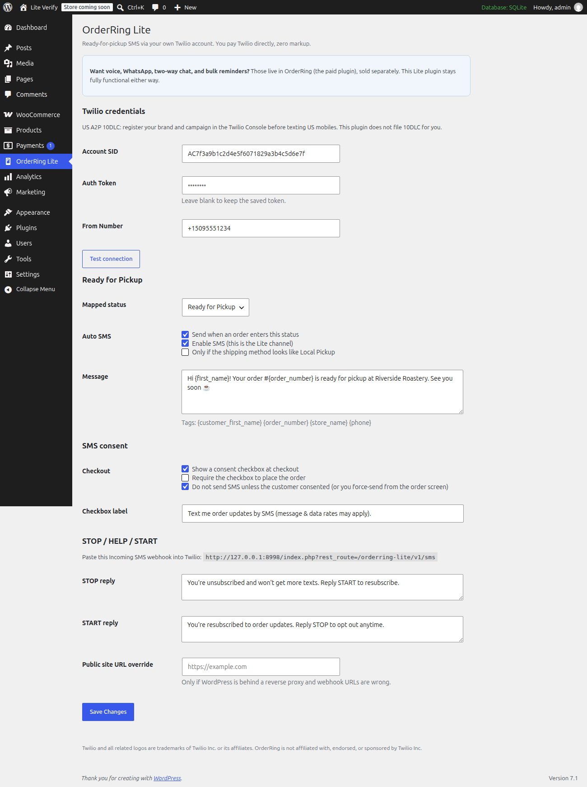
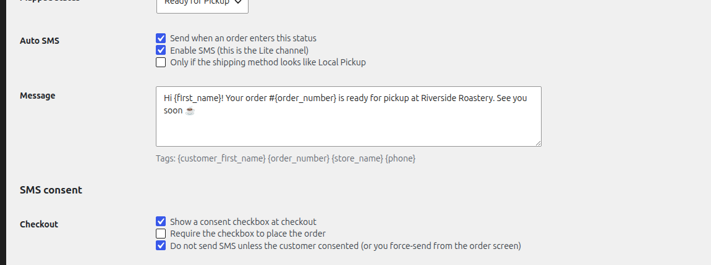
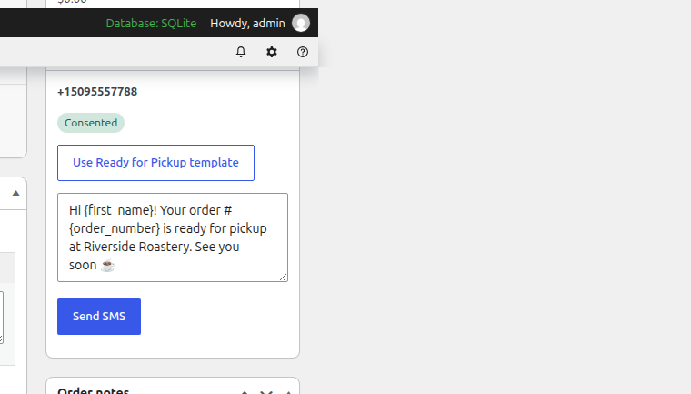
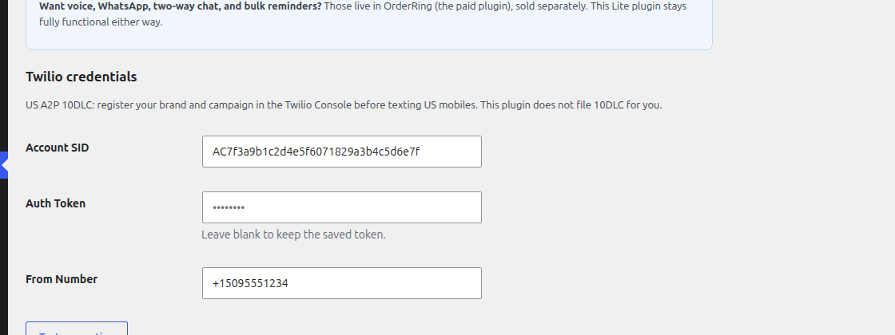

# OrderRing Lite

**Ready-for-pickup SMS for WooCommerce**, using **your** Twilio account.

You pay Twilio directly. OrderRing Lite adds no markup, no license key, no Tillpress account, and no phone-home.

- Send SMS from the order screen
- Auto SMS when an order enters **Ready for Pickup** (or any status you map)
- Checkout consent checkbox (classic + block checkout)
- STOP / HELP / START keyword handling
- Optional Local Pickup filter
- Compatible with WooCommerce HPOS

A paid [OrderRing](https://tillpress.com/orderring/) plugin (voice, WhatsApp, two-way chat, bulk reminders) is sold separately. It is a different plugin. Lite is complete and is never locked.

Author: [Tillpress](https://tillpress.com) (trade name of Alex Software Holdings LLC). Contact: info@tillpress.com.

Twilio and related logos are trademarks of Twilio Inc. or its affiliates. OrderRing is not affiliated with, endorsed, or sponsored by Twilio Inc.

## Install

**Use the Release zip, not GitHub’s “Source code” download.** WordPress needs a folder named `orderring-lite`. The source zip is named `orderring-lite-main` and will not activate cleanly.

1. Download `orderring-lite-1.0.6.zip` from [Releases](https://github.com/TillPress/orderring-lite/releases/latest).
2. In wp-admin: **Plugins → Add New → Upload Plugin**.
3. Activate. WooCommerce must already be active.
4. Open **OrderRing Lite** in the admin menu.

Also on [wordpress.org/plugins/orderring-lite](https://wordpress.org/plugins/orderring-lite/).

Requirements: WordPress 6.2+, PHP 7.4+, WooCommerce 7.0+.

## Setup

### 1. Twilio account

Create a Twilio account at [twilio.com](https://www.twilio.com/). You need:

| Field | Where to find it |
|---|---|
| Account SID | Twilio Console home |
| Auth Token | Twilio Console home (reveal) |
| From Number | A Twilio SMS number in E.164 (`+12025551212`) |

Paste those on **OrderRing Lite → Settings**. Click **Test connection** before sending to a customer.

Optional: keep credentials out of the database by defining in `wp-config.php`:

```php
define( 'ORLT_ACCOUNT_SID', 'ACxxxxxxxx' );
define( 'ORLT_AUTH_TOKEN', 'your-token' );
define( 'ORLT_FROM_NUMBER', '+12025551212' );
```

Constants override the settings fields. The older `ORL_` names still work.

A **Twilio trial** works for a smoke test, but Twilio will only send to numbers you have verified in the Twilio Console. Upgrade the Twilio account itself when you text real customers. This plugin does not sell Twilio service.

### 2. Incoming SMS webhook (STOP / HELP / START)

On the settings screen, copy the **Incoming SMS webhook URL**.

In Twilio Console → your number → **Messaging → A message comes in**:

- Method: HTTP POST
- URL: the webhook from OrderRing Lite

Without this, STOP will not opt the customer out on your store.

### 3. Ready for Pickup

Lite registers a **Ready for Pickup** order status. Map it on the settings screen (or point at an existing status). When an order enters that status, Lite can send the pickup SMS automatically if:

- Auto SMS is enabled
- The customer consented at checkout (if “require consent” is on)
- They have not texted STOP
- Optional: Local Pickup filter, if you turned that on

You can also send a one-off SMS from the order screen.

### 4. US carriers (A2P 10DLC)

If you text US mobile numbers, carriers require **A2P 10DLC** (or a verified toll-free number). Register brand + campaign in the Twilio Console. This plugin does not file it for you. Use the built-in checkout consent, STOP/HELP/START, and optional SMS footer so your campaign matches what you file.

## Screenshots









## FAQ

### Do I need a Tillpress account or license key?

No. Lite is self-contained. There is no account, no login, no license key, and no call to Tillpress servers.

### Who pays for texts?

You do, on your Twilio bill, at Twilio’s rates. Lite never holds a balance and never adds a per-text fee.

### How much does an SMS cost?

Whatever Twilio charges for that destination — typically a few cents in the US, more on some international routes, plus any A2P / sender-registration fees Twilio collects. Check Twilio’s current SMS pricing before you go live.

### What data leaves my site?

Only what you send to Twilio, and only when you (or auto-pickup) send a message: destination number, your From number, and the message body (which may include first name, order number, total, tracking from merge tags). Nothing is sent to Tillpress. See `readme.txt` → External services.

### What if I also install paid OrderRing?

Lite steps aside so you do not send duplicate SMS. While both are active, Lite stays idle and shows a notice on Plugins. You can deactivate Lite.

### Can I install from this GitHub repo with “Download ZIP”?

No. Use the **Release** asset (`orderring-lite-1.0.6.zip`). GitHub’s source zip has the wrong folder name.

### Where do I get help?

Email **info@tillpress.com**. Docs and the paid plugin: [tillpress.com/orderring](https://tillpress.com/orderring/).

## License

GPLv2 or later. See [LICENSE](LICENSE).
